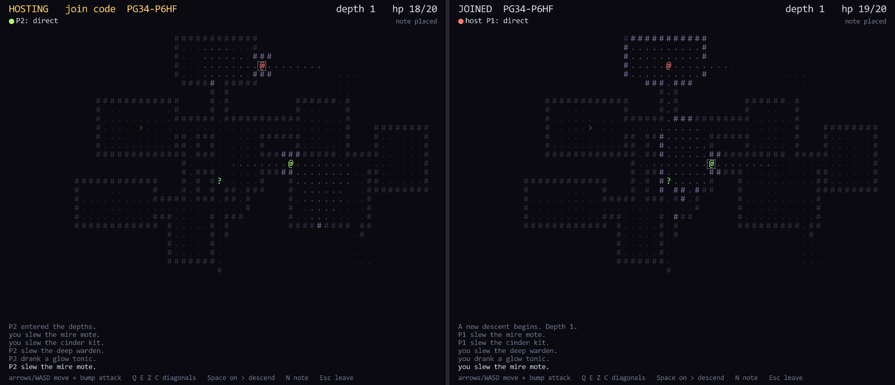

# The Cosmos

Serverless online for small co-op games: 2 to 4 players, no game server, no
matchmaking server. A Rust library with a plain C API (`include/cosmos.h`),
so any engine or language that can call C can use it.

**Try it:** [Cosmos Depths in your browser](https://joaovitor404silva.github.io/cosmos-depths/),
the demo game built on the SDK.



## What it does

| | |
| --- | --- |
| **Join codes** | `cosmos_host` gives a short code like `K7QM-2XPD`; friends `cosmos_join` it. The code is never published as is: runs are found under an Argon2id-derived key, and the code is bound to the host's key. |
| **Sessions** | Host-admitted, full mesh, up to 4 peers. Per peer: a reliable ordered channel and an unreliable one. |
| **Paths** | LAN / IPv6 / UPnP direct, then hole punching, then the **Steam relay** (Steam Datagram Relay) when the player's Steam client runs. The session moves back to direct as soon as a direct path holds. |
| **Records** | Signed, short-lived key/value records on a Kademlia DHT for everything that can arrive late: notes, ghosts, lobby listings, profiles. Query and subscribe. |
| **Events** | One poll loop (`cosmos_poll`): peer joined/left, message, path changed, record result/update, session ended. No callbacks across threads. |

Lag on the async plane (records) never touches the session. Rule of thumb: if
the game can live with it arriving late, make it a record.

## Layout

| Path | |
| --- | --- |
| `crates/cosmos-net` | libp2p swarm, DHT, gossipsub, direct/punch ladder, path migration |
| `crates/cosmos-core` | identity keys, sessions, channels, records, limits |
| `crates/cosmos-steam` | optional Steam relay path (`steamnetworkingmessages`), loaded at run time |
| `crates/cosmos-ffi` | the C ABI (`cosmos` cdylib + staticlib), header `include/cosmos.h` |
| `examples/chat.c` | smallest C example: 4 instances, a join code, a broadcast, a record |
| `examples/cosmos-depths` | the demo game (C + raylib): co-op roguelike with notes, graves, ghosts and a lobby list |
| `examples/cosmos-depths/web` | the same game in the browser, with a JavaScript backend over public Nostr relays and WebRTC |
| `docs/` | design and plan |

## Use it from C

```c
cosmos_config_t cfg = {0};
cfg.game_id = "my-game";                 /* namespaces codes and records */
cosmos_t *c = cosmos_init(&cfg);

char code[16];
cosmos_host(c, code, sizeof code);       /* or: cosmos_join(c, "K7QM-2XPD") */

cosmos_event_t ev;
for (;;) {                                /* once per frame */
    while (cosmos_poll(c, &ev) > 0) { /* COSMOS_EV_PEER_JOINED, ..._MESSAGE, ... */ }
    cosmos_send(c, COSMOS_BROADCAST, 1, data, len, 1 /* reliable */);
}
cosmos_shutdown(c);
```

Calls return `COSMOS_OK` (0) or a negative `COSMOS_E_*`; `cosmos_last_error()` has the
text. The header documents every call.

## Build

Needs Rust (edition 2024).

    cargo build --release          # target/release: cosmos.dll + cosmos.dll.lib, static cosmos.lib
    cargo test

The demo game (Windows, MSVC): `powershell -ExecutionPolicy Bypass -File examples\cosmos-depths\build.ps1`,
then `dist\cosmos-depths\cosmos-depths.exe`. See [its README](examples/cosmos-depths/README.md),
and [the web README](examples/cosmos-depths/web/README.md) for the browser build.

### Steam relay

Optional. Put Valve's `steam_api64.dll` (Steamworks SDK redistributable) next
to the game and set `steam_app_id` to your game's AppID. If the game already
runs Steam in-process, the SDK reuses it. Without the Steam client the SDK
still works over direct and hole-punched paths; when neither works the join
fails with an error. Release builds never start Steam
without an AppID; debug builds fall back to Valve's test app 480.

## Status

Early. Developed and tested on Windows (loopback, LAN, browsers); cross-network play across
many NAT types and the live two-account Steam relay test are still to do.
Not audited for production use. The browser backend is not wire-compatible
with native instances.
