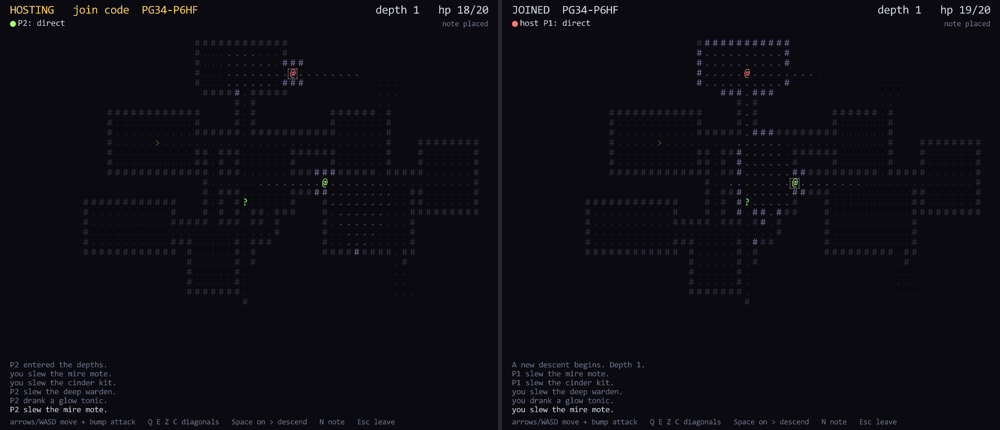

# Cosmos Depths

A small original co-op roguelike for 1-4 players, built on The Cosmos SDK C
API (`cosmos.h` only) and raylib. Go down through generated dungeon levels
together, bump monsters to fight them, drink tonics, take the stairs. Leave
notes on the floor; where a player dies, a grave stays. Later runs, in other
sessions, find both.



## Play

- Run `cosmos-depths.exe`. Press **H** to host: the join code shows at the top.
- Friends press **J**, type the code and press Enter. You can join mid-run.
- **Arrows / WASD** step (bump a monster to attack), **Q E Z C** or the
  numpad diagonals, **Space** on `>` to go down (everyone goes), **N** write
  a note on your tile, **Esc** leave.
- `@` players, `m` mire mote, `k` cinder kit, `W` deep warden, `!` glow
  tonic (+8 HP), `?` a note, `+` a grave. Stand next to a mark to read it.
- When everyone has fallen, a new descent starts at depth 1. Fallen players
  get back up on the next level.
- The HUD shows the path to each peer: `direct` (direct or hole-punched) or
  `Steam relay`. Steam relay is on when `steam_api64.dll` is next to the exe
  (and Steam is running).

## How it uses the SDK

Sync plane, channel 1, host authoritative:

| message | from -> to | delivery | content |
|---|---|---|---|
| `LEVEL` | host -> all | reliable | seed + depth; every peer builds the same map |
| `INTENT` | player -> host | reliable | numbered step / attack / descend |
| `SNAP` | host -> all | unreliable, 6/s | players (spot, HP, last applied intent), monsters, tonics |
| `EVENT` | host -> all | reliable | kill, death (with cause), pickup |
| `HELLO` | any -> any | reliable | the player's tag (identity, colour) |

The host runs the monsters and the fights on a 6 Hz tick. Clients move their
own `@` at once (prediction) and replay their unacknowledged intents over each
snapshot. A late joiner gets `LEVEL` plus a reliable `SNAP`.

Async plane, records (DHT), key `d<depth>` so any run of that depth sees them:
`note` = room index, offset in the room, text; `grave` = the same with the
cause of death. Room + offset places a mark on any map of that depth. One
record per player and kind per depth (a new one replaces it); records live
30 minutes (the SDK cap). Queried on every level enter and subscribed for live
updates.

`cosmos_host` / `cosmos_join` / `cosmos_record_put` block, so they run on a
worker thread; `cosmos_poll` runs once per frame on the main thread.

Files: `src/dungeon.c` level generation, `src/game.c` rules + network,
`src/main.c` window and drawing, `src/selftest.c`, `src/plat.c` Windows bits.

## Settings

`cosmos-depths.ini` next to the exe (`name = value` lines), overridden by
`--name value` flags:

| name        | meaning                                                    |
|-------------|------------------------------------------------------------|
| `listen`    | IP to listen on, e.g. `127.0.0.1` (default: all)           |
| `bootstrap` | comma-separated multiaddrs to bootstrap the DHT from       |
| `lan`       | 1 (default): LAN discovery + UPnP, 0: off                  |
| `steam`     | 1 / 0 forces the Steam path on / off                       |
| `app-id`    | Steam AppID for our own Steam init (default 480)           |
| `key`       | key file: keeps your player id (and your marks) across runs |
| `cache`     | record cache directory                                     |
| `addr-file` | write this instance's listen addrs to a file               |

Other flags: `--host`, `--join CODE`, `--join @FILE` (join once FILE holds a
code), `--bot` (autoplay), `--window X,Y`, `--shot FILE` / `--shot-after SECS`
(save one frame of this window, quit 6 s later), `--selftest`.

Two windows on one PC:

```
cosmos-depths --listen 127.0.0.1 --lan 0 --addr-file addr.txt --host
cosmos-depths --listen 127.0.0.1 --lan 0 --bootstrap <contents of addr.txt> --join CODE
```

## Self-test

`cosmos-depths --selftest` runs games in one process on loopback, no window:
a host and two joiners by code, then a late fourth joiner, then a fresh
instance outside the session. It checks: the same map from the seed on every
peer; a predicted move confirmed by the host; a monster killed by one player
gone for all; the late joiner gets the seed, the dead monster and every
position; a note arrives live by subscription and is queried back by the
fresh instance; a death mark is queried back by the fresh instance. Prints
`SELFTEST OK` and exits 0, or 1. `cargo test -p cosmos-ffi --test depths_c`
builds the game and runs it.

## Build

```
powershell -ExecutionPolicy Bypass -File examples\cosmos-depths\build.ps1
```

Downloads raylib 5.5 (official MSVC x64 build, zlib license, hash-checked)
into `examples/cosmos-depths/vendor/raylib`, builds `cosmos.dll` (release) and
the exe with MSVC, and writes `dist/cosmos-depths/`. Put `steam_api64.dll` in
`vendor/steam/` (or pass `-SteamDir`) to ship it.

Everything is drawn as text glyphs (Consolas when present); no external assets.
raylib (c) Ramon Santamaria, zlib/libpng license (`raylib-LICENSE.txt`).
